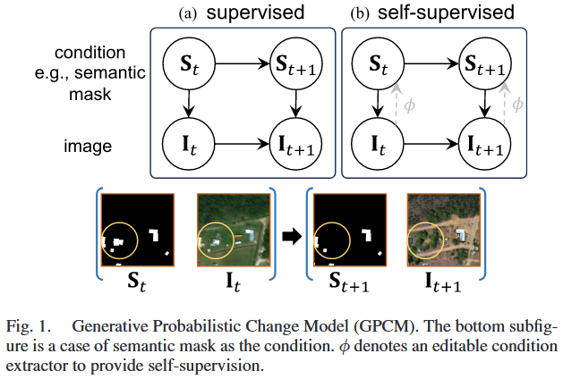

> 论文链接：https://ieeexplore.ieee.org/document/10713915
> 代码链接：https://github.com/Z-Zheng/pytorch-change-models
> 作者单位：斯坦福大学

## 背景（为什么要研究）

变化检测是地球视觉中最基础的任务之一，目标是理解地球表面随时间的动态变化。在遥感与计算机视觉领域的联合发展下，变化检测取得巨大进展。近年来，基于孪生网络的深度学习变化检测模型占据主导地位。它们成功的关键在于大规模标记训练数据集。然而，构建大规模遥感变化检测数据集既困难又昂贵，因为收集（识别发生变化事件的图像序列）、预处理（例如需要额外的图像注册）和注释遥感图像时间序列，相比单图像任务准备数据集需要更多的专业知识和精力。

## 问题（现有方法不足）

- 基于图的合成数据：3D建模是劳动密集型
- 基于数据增强的合成数据：受限于现有变化检测数据集的规模，贵么和多样性不足
- 合成数据的质量和多样性与特征的可迁移性的关系尚不明确

## 动机（从问题到方法的思考过程）

- 根本目标：构建基于变化生成建模的可扩展多时相变化数据生成器：通过模拟变化过程，从单时相图像和其标注（语义分割掩码、目标计数结果）生成真实且丰富多样的多时相图像及其密集标签
- 问题定义：设变化事件前后图像及其对应的条件（如：语义分割掩码）为 $<I_t, S_t>, <I_{t-1}, S_{t-1}>$。
  - 如上图所示，事后数据由事前数据驱动，若假设为生成任务，则图像内容取决于其条件
  - 问题拆分：条件级别的变化事件模拟、图像级别的语义变化合成

## 方法

- 变化事件模拟
  - 物体增加：采样实体后粘贴
  - 物体减少：采样实体后置零
  - 属性改变：类别转移矩阵，统一设置转移概率
- Changen：GAN
  - 编码器编码事前图像得到条件，解码器作为条件生成器生成事后图像
  - 存在问题
    - 特征泄露：仅仅复制事前图像，而不根据条件生成
    - 缺少真值
  - masked transition layer：解决特征泄露
  - bitemporal adversarial learning：只用事前图像和语义掩码训练
  - 模型局限
    - 零样本预测能力与全监督模型差距大
    - 不支持多类别变化生成
    - 需要单时相图像标注
- Changen2：DM
  - 动机：问题指向条件生成能力和监督信号
  - 模型结构：
    - transformer-based diffusion model：解决 GAN 的对抗学习的模式崩溃问题和不可控问题
      - 自注意力的二次复杂性
        - 方法：使用local window attention替换除能整除4之外的层的自注意力
    - resolution-scalable diffusion transformer：解决高分辨率训练昂贵，低分辨率训练难以生成高分辨率结果问题
      - 绝对位置编码 is the key of 限制分辨率可扩展性
        - 实验得知，为了一个新分辨率对基于频率的位置编码进行插值或重生是无效的
        - 方法：移除绝对位置编码，在每个Transformer block的FFN中插入一个3*3深度卷积层，其通过 zero-padding 提供相对位置信息（参考文献：ICLR 20 | How much position information do convolutional neural networks encode?）
    - 密集编码网络：使密集标签能够作为条件输入
      - conv-layernorm-SiLU block\*8，downsampling\*2
  - 训练
    - 目标：在单时相上训练，形式遵循diffusion
    - 自监督训练方法：无需单时相图像标注
      - 语义掩码条件由函数使用原始图像生成，如：SAM得到mask，再到轮廓
  - 推理
    - 模拟变化事件，生成事后语义掩码
    - 根据事前后语义掩码，生成变化掩码
    - 从噪声采样事后图像，根据变化掩码，映射对应时间步的事前未变化部分
    - 使用训练的生成模型，将事后语义掩码视为条件，进行去噪生成