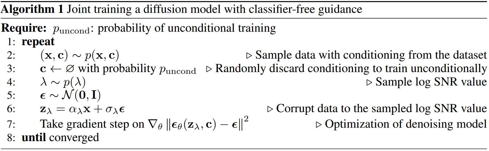
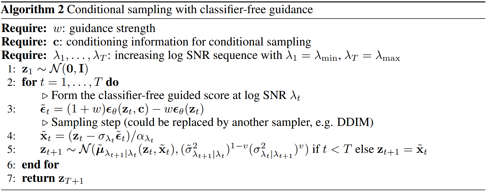

> 论文链接：https://doi.org/10.48550/arXiv.2207.12598
> 作者单位：谷歌研究院

## 动机

基于 GAN 或 Flow 的模型可以通过减少采样时输入噪声的方差或范围实现阶段采样或低温采样，牺牲多样性，提高样本质量。然而这在 Diffusion 中不奏效

Classifier Guidance 将扩散模型的分数估计与分类器对数概率相对于输入的梯度进行了融合。通过调节分类器梯度的强度实现 Inception 分数与 FID 分数的平衡
但该方法需要训练单独的一个分类器，而作用仅是将扩散模型估计向分类方向矫正

因此探索无分类器引导方法，混合条件扩散模型和无条件扩散模型的分数估计，通过调节混合权重，实现 Inception 分数与 FID 分数的平衡

## 方法

训练过程

采样过程

