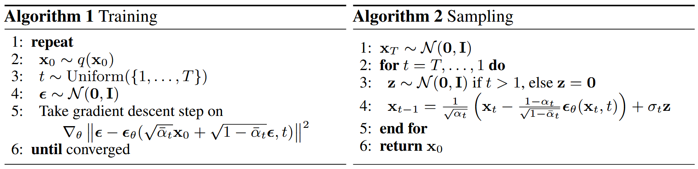

> 论文链接：https://proceedings.neurips.cc/paper/2020/hash/4c5bcfec8584af0d967f1ab10179ca4b-Abstract.html
> 代码链接：https://github.com/hojonathanho/diffusion
> 作者单位：加州大学伯克利分校

> 数学基础：
> - 高斯分布重参数化公式：$x \sim \mathcal{N}(\mu,\sigma^2) \Rightarrow x=\mu+\sigma\epsilon, \epsilon \sim \mathcal{N}(0,1)$
> - 期望公式：
>   - 连续变量：$E[X] = \int xp(x)\mathrm{d}x$
>   - 函数：$E[g(X)] = \int g(x)p(x)\mathrm{d}x$
> - 高斯分布密度公式：$\mathcal{N}(x;\mu,\sigma^2\mathbf{I}) = \frac{1}{(2\pi\sigma^2)^{d/2}}\exp(-\frac{||x-\mu||^2}{2\sigma^2})$，$d$ 表示随机变量的维度
> - 高斯分布 KL 散度：$D_{KL}(\mathcal{N}(\mu_1,\Sigma_1)||\mathcal{N}(\mu_2,\Sigma_2)) = \frac{1}{2}[(\mu_2-\mu_1)^\top \Sigma_2^{-1}(\mu_2-\mu_1) + tr(\Sigma_2^{-1}\Sigma_1) + \log \frac{|\Sigma_2|}{|\Sigma_1|} - d]$，$d$ 表示随机变量的维度

## 背景知识

前向过程：
$$
\begin{aligned}
x_0 &\sim q(x_0)\\
q(x_{1:T} \mid x_0) &:= \prod_{t=1}^T q(x_t \mid x_{t-1})\\
q(x_t \mid x_{t-1}) &:= \mathcal{N}(x_t; \sqrt{1-\beta_t} x_{t-1}, \beta_t\mathbf{I})
\end{aligned}
$$

令 $\alpha_t := 1-\beta_t$，重参数化后有：
$$
\begin{aligned}
x_t &= \sqrt{1-\beta_t} x_{t-1} + \sqrt{\beta_t}\epsilon_t\\
&= \sqrt{\alpha_t} x_{t-1} + \sqrt{1-\alpha_t}\epsilon_t
\end{aligned}
$$

逐项展开有：
$$
\begin{aligned}
x_1 &= \sqrt{\alpha_1} x_0 + \sqrt{1-\alpha_1}\epsilon_1\\
x_2 &= \sqrt{\alpha_2} x_1 + \sqrt{1-\alpha_2}\epsilon_2\\
&= \sqrt{\alpha_1\alpha_2} x_0 + \sqrt{\alpha_2(1-\alpha_1)}\epsilon_1 + \sqrt{1-\alpha_2}\epsilon_2\\
&= \sqrt{\alpha_1\alpha_2} x_0 + \sqrt{1-\alpha_1\alpha_2}\epsilon && 独立标准高斯线性组合
\end{aligned}
$$

令 $\bar{\alpha}_t := \prod_{s=1}^t \alpha_s$，可推导**一步加噪公式**为：
$$
x_t = \sqrt{\bar{\alpha}_t} x_0 + \sqrt{1-\bar{\alpha}_t}\epsilon, \epsilon \sim \mathcal{N}(0,1)
$$

对应的边缘分布为：
$$
q(x_t \mid x_0) := \mathcal{N}(x_t; \sqrt{\bar{\alpha}_t}x_0, (1-\bar{\alpha}_t)\mathbf{I})
$$

后向过程：
$$
\begin{aligned}
p(x_T) &= \mathcal{N}(x_T;0,\mathbf{I})\\
p_\theta(x_{0:T}) &:= p(x_T)\prod_{t=1}^T p_\theta(x_{t-1} \mid x_t)\\
p_\theta(x_{t-1} \mid x_t) &:= \mathcal{N}(x_{t-1}; \mu_\theta(x_t,t), \Sigma_\theta(x_t,t))
\end{aligned}
$$

## 训练目标

最小化负对数似然：$\int \mathrm{d}x^{(0)} q(x^{(0)}) (-\log p(x^{(0)})) = \mathbb{E}_{x_0 \sim q(x_0)}[-\log p_\theta(x_0)]$（按照真实数据分布 $q(x^{(0)})$ 加权平均）

对其变分上界的推导如下：
$$
\begin{aligned}
\mathbb{E}_{x_0 \sim q(x_0)}[-\log p_\theta(x_0)] &= \mathbb{E}_{x_0 \sim q(x_0)}[-\log \int p_\theta(x_{0:T}) \mathrm{d}x_{1:T}]\\
&= \mathbb{E}_{x_0 \sim q(x_0)}[-\log \int p_\theta(x_{0:T}) \frac{q(x_{1:T} \mid x_0)}{q(x_{1:T} \mid x_0)} \mathrm{d}x_{1:T}]\\
&= \mathbb{E}_{x_0 \sim q(x_0)}[-\log \mathbb{E}_{q(x_{1:T} \mid x_0)} \frac{p_\theta(x_{0:T})}{q(x_{1:T} \mid x_0)}] && 构造期望\\
&\le \mathbb{E}_{x_0 \sim q(x_0)}\mathbb{E}_{q(x_{1:T} \mid x_0)} [-\log \frac{p_\theta(x_{0:T})}{q(x_{1:T} \mid x_0)}] && Jensen 不等式，-\log 为凸函数\\
&= \mathbb{E}_{x_{0:T} \sim q(x_{0:T})}[-\log \frac{p_\theta(x_{0:T})}{q(x_{1:T} \mid x_0)}] && 合并期望\\
&= \mathbb{E}_{q}[-\log p(x_T) \prod_{t=1}^T \frac{p_\theta(x_{t-1} \mid x_t)}{q(x_t \mid x_{t-1})}] && 按定义展开\\
&= \mathbb{E}_{q}[-\log p(x_T) - \sum_{t=1}^T \log \frac{p_\theta(x_{t-1} \mid x_t)}{q(x_t \mid x_{t-1})}]\\
&= \mathbb{E}_{q}[-\log p(x_T) - \sum_{t=2}^T \log \frac{p_\theta(x_{t-1} \mid x_t)}{q(x_t \mid x_{t-1})} - \log \frac{p_\theta(x_0 \mid x_1)}{q(x_1 \mid x_0)}] && 处理t=1\\
&= \mathbb{E}_{q}[-\log p(x_T) - \sum_{t=2}^T \log \frac{p_\theta(x_{t-1} \mid x_t)}{\color{red}q(x_t \mid x_{t-1}, x_0)} - \log \frac{p_\theta(x_0 \mid x_1)}{q(x_1 \mid x_0)}] && 马尔戈夫性质\\
&= \mathbb{E}_{q}[-\log p(x_T) - \sum_{t=2}^T \log \frac{p_\theta(x_{t-1} \mid x_t)}{\color{red}q(x_{t-1} \mid x_t, x_0)} \cdot \frac{\color{red}q(x_{t-1} \mid x_0)}{\color{red}q(x_t \mid x_0)} - \log \frac{p_\theta(x_0 \mid x_1)}{q(x_1 \mid x_0)}] && 贝叶斯公式\\
&= \mathbb{E}_{q}[-\log p(x_T) - \sum_{t=2}^T \log \frac{p_\theta(x_{t-1} \mid x_t)}{q(x_{t-1} \mid x_t, x_0)} - \log \prod_{t=2}^T \frac{q(x_{t-1} \mid x_0)}{q(x_t \mid x_0)} - \log \frac{p_\theta(x_0 \mid x_1)}{q(x_1 \mid x_0)}]\\
&= \mathbb{E}_{q}[-\log p(x_T) - \sum_{t=2}^T \log \frac{p_\theta(x_{t-1} \mid x_t)}{q(x_{t-1} \mid x_t, x_0)} - \log \frac{q(x_1 \mid x_0)}{q(x_T \mid x_0)} - \log \frac{p_\theta(x_0 \mid x_1)}{q(x_1 \mid x_0)}] && 逐项抵消\\
&= \mathbb{E}_{q}[- \log \frac{p(x_T)}{q(x_T \mid x_0)} - \sum_{t=2}^T \log \frac{p_\theta(x_{t-1} \mid x_t)}{q(x_{t-1} \mid x_t, x_0)} - \log p_\theta(x_0 \mid x_1)] && 按 t 合并整理 \log 项\\
&= \mathbb{E}_{q(x_0)}[D_{KL}(q(x_T \mid x_0) || p(x_T))] + \sum_{t=2}^T \mathbb{E}_{q(x_0, x_t)}[D_{KL}(q(x_{t-1} \mid x_t, x_0) || p_\theta(x_{t-1} \mid x_t))] + \mathbb{E}_{q(x_0, x_1)}[-\log p_\theta(x_0 \mid x_1)] && 转为 KL 散度
\end{aligned}
$$

对于模型逼近的主要目标分布 $q(x_{t-1} \mid x_t, x_0)$ 有如下推导：
$$
\begin{aligned}
q(x_{t-1} \mid x_t, x_0) &= \frac{q(x_t \mid x_{t-1}, x_0)q(x_{t-1} \mid x_0)}{q(x_t \mid x_0)} && 贝叶斯\\
&= \frac{q(x_t \mid x_{t-1})q(x_{t-1} \mid x_0)}{q(x_t \mid x_0)} && 马尔可夫\\
&\propto q(x_t \mid x_{t-1})q(x_{t-1} \mid x_0) && x_t，x_0 已给定，q(x_t \mid x_0) 视为常数
\end{aligned}
$$

由于 $q(x_t \mid x_{t-1}) = \mathcal{N}(x_t; \sqrt{\alpha_t} x_{t-1}, \beta_t \mathbf{I})$，$q(x_{t-1} \mid x_0) = \mathcal{N}(x_{t-1}; \sqrt{\bar{\alpha}_{t-1}}x_0, (1-\bar{\alpha}_{t-1})\mathbf{I})$，展开为高斯概率密度公式，带回得：
$$
\begin{aligned}
q(x_{t-1} \mid x_t, x_0) &\propto q(x_t \mid x_{t-1})q(x_{t-1} \mid x_0)\\
&= \frac{1}{(2\pi\beta_t)^{d/2}} \frac{1}{(2\pi(1-\bar{\alpha}_{t-1}))^{d/2}} \exp(-\frac{||x_t - \sqrt{\alpha_t} x_{t-1}||^2}{2\beta_t}) \exp(-\frac{||x_{t-1} - \sqrt{\bar{\alpha}_{t-1}}x_0||^2}{2(1-\bar{\alpha}_{t-1})})\\
&= \frac{1}{C} \exp(-\frac{||x_t - \sqrt{\alpha_t} x_{t-1}||^2}{2\beta_t} - \frac{||x_{t-1} - \sqrt{\bar{\alpha}_{t-1}}x_0||^2}{2(1-\bar{\alpha}_{t-1})}) && 合并无关常数\\
&= \frac{1}{C} \exp(-\frac{1}{2\beta_t}||x_t||^2 + \frac{\sqrt{\alpha_t}}{\beta_t}x_{t-1}x_t - \frac{\alpha_t}{2\beta_t}||x_{t-1}||^2 - \frac{1}{2(1-\bar{\alpha}_{t-1})}||x_{t-1}||^2 + \frac{\sqrt{\bar{\alpha}_{t-1}}}{1-\bar{\alpha}_{t-1}}x_0x_{t-1} - \frac{\bar{\alpha}_{t-1}}{2(1-\bar{\alpha}_{t-1})}||x_0||^2)\\
&= \frac{1}{C} \exp(-\frac{1}{2}(\frac{\alpha_t}{\beta_t} + \frac{1}{1-\bar{\alpha}_{t-1}}){\color{red}||x_{t-1}||^2} + (\frac{\sqrt{\alpha_t}}{\beta_t}x_t + \frac{\sqrt{\bar{\alpha}_{t-1}}}{1-\bar{\alpha}_{t-1}}x_0){\color{red}x_{t-1}} - \frac{1}{2\beta_t}||x_t||^2 - \frac{\bar{\alpha}_{t-1}}{2(1-\bar{\alpha}_{t-1})}||x_0||^2)
\end{aligned}
$$

设 $q(x_{t-1} \mid x_t, x_0) = \mathcal{N}(x_{t-1}; \tilde{\mu}_t(x_t, x_0), \tilde{\beta}_t\mathbf{I})$ 其概率密度展开的指数部分为：
$$
-\frac{||x_{t-1} - \tilde{\mu}_t(x_t, x_0)||^2}{2\tilde{\beta}_t} = -\frac{1}{2\tilde{\beta}_t}{\color{red}||x_{t-1}||^2} + \frac{\tilde{\mu}_t(x_t, x_0)}{\tilde{\beta}_t}{\color{red}x_{t-1}} - \frac{1}{2\tilde{\beta}_t}||\tilde{\mu}_t(x_t, x_0)||^2
$$

对比系数得：
$$
\begin{aligned}
-\frac{1}{2\tilde{\beta}_t} &= -\frac{1}{2}(\frac{\alpha_t}{\beta_t} + \frac{1}{1-\bar{\alpha}_{t-1}})\\
\frac{1}{\tilde{\beta}_t} &= \frac{\alpha_t(1-\bar{\alpha}_{t-1}) + \beta_t}{\beta_t(1-\bar{\alpha}_{t-1})} = \frac{\alpha_t-\bar{\alpha}_t + \beta_t}{\beta_t(1-\bar{\alpha}_{t-1})} = \frac{1 - \beta_t - \bar{\alpha}_t + \beta_t}{\beta_t(1-\bar{\alpha}_{t-1})}\\
\tilde{\beta}_t &= \frac{1-\bar{\alpha}_{t-1}}{1 - \bar{\alpha}_t}\beta_t
\end{aligned}
$$

带入 $\tilde{\beta}_t = \frac{1-\bar{\alpha}_{t-1}}{1 - \bar{\alpha}_t}\beta_t$ 对比系数得：
$$
\begin{aligned}
\frac{\tilde{\mu}_t(x_t, x_0)}{\tilde{\beta}_t} &= \frac{\sqrt{\alpha_t}}{\beta_t}x_t + \frac{\sqrt{\bar{\alpha}_{t-1}}}{1-\bar{\alpha}_{t-1}}x_0\\
\tilde{\mu}_t(x_t, x_0) &= (\frac{\sqrt{\alpha_t}}{\beta_t}x_t + \frac{\sqrt{\bar{\alpha}_{t-1}}}{1-\bar{\alpha}_{t-1}}x_0) \frac{1-\bar{\alpha}_{t-1}}{1 - \bar{\alpha}_t}\beta_t\\
&= \frac{\sqrt{\bar{\alpha}_{t-1}}\beta_t}{1 - \bar{\alpha}_t}x_0 + \frac{\sqrt{\alpha_t}(1-\bar{\alpha}_{t-1})}{1 - \bar{\alpha}_t}x_t
\end{aligned}
$$

### 前向过程和 $L_T$

对于负对数似然的变分上界中的第一项 $L_T = \mathbb{E}_{q(x_0)}[D_{KL}(q(x_T \mid x_0) || p(x_T))]$ 当方差 $\beta_t$ 设计为固定常数，则 $q(x_T \mid x_0)$ 固定，该项无可学习参数，故可忽略

### 反向过程和 $L_{1:T-1}$

对于负对数似然的变分上界中的第二项 $L_{1:T-1} = \sum_{t=2}^T \mathbb{E}_{q(x_0, x_t)}[D_{KL}(q(x_{t-1} \mid x_t, x_0) || p_\theta(x_{t-1} \mid x_t))]$ 设 $p_\theta(x_{t-1} \mid x_t) = \mathcal{N}(x_{t-1}; \mu_\theta(x_t,t), \Sigma_\theta(x_t,t))$

由于 $q(x_{t-1} \mid x_t, x_0) = \mathcal{N}(x_{t-1};\tilde{\mu}_t(x_t,x_0), \tilde{\beta}_t\mathbf{I})$ 和 $p_\theta(x_{t-1} \mid x_t) = \mathcal{N}(x_{t-1}; \mu_\theta(x_t,t), \Sigma_\theta(x_t,t))$ 均为高斯分布，我们可以用高斯分布 KL 散度公式对该项展开：
$$
\begin{aligned}
L_t &= \mathbb{E}_{q(x_0, x_t)}[D_{KL}(q(x_{t-1} \mid x_t, x_0) || p_\theta(x_{t-1} \mid x_t))]\\
&= \mathbb{E}_q[\frac{1}{2}[\log \frac{|\Sigma_\theta|}{|\tilde{\beta}_t\mathbf{I}|} - d + tr(\Sigma_\theta^{-1}\tilde{\beta}_t\mathbf{I}) + (\mu_\theta - \tilde{\mu}_t)^\top\Sigma_\theta^{-1}(\mu_\theta - \tilde{\mu}_t)]]
\end{aligned}
$$

关于方差 $\Sigma_\theta(x_t,t)$ 的设计，有两种性能相近的选择，即 $\Sigma_\theta(x_t,t) = \beta_t$ 或 $\Sigma_\theta(x_t,t) = \tilde{\beta}_t = \frac{1-\bar{\alpha}_{t-1}}{1-\bar{\alpha}_t}\beta_t$，我们采用 $\beta_t$，带入 KL 散度展开式有：
$$
\begin{aligned}
L_t &= \mathbb{E}_q[\frac{1}{2}[d\log \frac{\beta_t}{\tilde{\beta}_t} - d + d\frac{\tilde{\beta}_t}{\beta_t} + \frac{1}{\beta_t}||\mu_\theta - \tilde{\mu}_t||_2^2]]\\
&= \mathbb{E}_q[\frac{1}{2\beta_t}||\mu_\theta - \tilde{\mu}_t||_2^2 + {\color{red}\frac{d}{2}[\log \frac{\beta_t}{\tilde{\beta}_t} - 1 + \frac{\tilde{\beta}_t}{\beta_t}]}]\\
&= \mathbb{E}_q[\frac{1}{2\beta_t}||\mu_\theta - \tilde{\mu}_t||_2^2 + C] && 合并无关常数
\end{aligned}
$$

其中，$C$ 为不含可学习参数的常数，由此，逼近目标变为 $\tilde{\mu}_t(x_t, x_0)$，由于预测模型不接收 $x_0$，可用一步加噪公式将 $\tilde{\mu}_t(x_t, x_0)$ 中的 $x_0$ 转为噪声。由一步加噪公式得：
$$
\begin{aligned}
x_t &= \sqrt{\bar{\alpha}_t} x_0 + \sqrt{1-\bar{\alpha}_t}\epsilon\\
x_0 &= \frac{1}{\sqrt{\bar{\alpha}_t}}x_t - \frac{\sqrt{1-\bar{\alpha}_t}}{\sqrt{\bar{\alpha}_t}}\epsilon
\end{aligned}
$$

带入 $\tilde{\mu}_t(x_t, x_0)$ 得：
$$
\begin{aligned}
\tilde{\mu}_t(x_t, x_0) &= \frac{\sqrt{\bar{\alpha}_{t-1}}\beta_t}{1 - \bar{\alpha}_t}x_0 + \frac{\sqrt{\alpha_t}(1-\bar{\alpha}_{t-1})}{1 - \bar{\alpha}_t}x_t\\
&= \frac{\sqrt{\bar{\alpha}_{t-1}}\beta_t}{1 - \bar{\alpha}_t}(\frac{1}{\sqrt{\bar{\alpha}_t}}x_t - \frac{\sqrt{1-\bar{\alpha}_t}}{\sqrt{\bar{\alpha}_t}}\epsilon) + \frac{\sqrt{\alpha_t}(1-\bar{\alpha}_{t-1})}{1 - \bar{\alpha}_t}x_t\\
&= (\frac{\sqrt{\bar{\alpha}_{t-1}}\beta_t}{\sqrt{\bar{\alpha}_t}(1 - \bar{\alpha}_t)} + \frac{\sqrt{\alpha_t}(1-\bar{\alpha}_{t-1})}{1 - \bar{\alpha}_t})x_t - \frac{\sqrt{1-\bar{\alpha}_t}\sqrt{\bar{\alpha}_{t-1}}\beta_t}{\sqrt{\bar{\alpha}_t}(1 - \bar{\alpha}_t)}\epsilon\\
&= \frac{\sqrt{\bar{\alpha}_{t-1}}\beta_t + \sqrt{\bar{\alpha}_t}\sqrt{\alpha_t}(1-\bar{\alpha}_{t-1})}{\sqrt{\bar{\alpha}_t}(1 - \bar{\alpha}_t)}x_t - \frac{\beta_t}{\sqrt{\alpha_t}\sqrt{1 - \bar{\alpha}_t}}\epsilon\\
&= \frac{\beta_t + \alpha_t(1-\bar{\alpha}_{t-1})}{\sqrt{\alpha_t}(1 - \bar{\alpha}_t)}x_t - \frac{\beta_t}{\sqrt{\alpha_t}\sqrt{1 - \bar{\alpha}_t}}\epsilon\\
&= \frac{1}{\sqrt{\alpha_t}}(x_t - \frac{\beta_t}{\sqrt{1 - \bar{\alpha}_t}}\epsilon)
\end{aligned}
$$

此时我们可以考虑 $\mu_\theta(x_t,t)$ 的设计，若设：
$$
\mu_\theta(x_t,t) = \frac{1}{\sqrt{\alpha_t}}(x_t - \frac{\beta_t}{\sqrt{1 - \bar{\alpha}_t}}\epsilon_\theta(x_t,t))
$$

则可将形式对齐的 $\tilde{\mu}_t(x_t, x_0)$ 和 $\mu_\theta(x_t,t)$ 带入 KL 散度展开式，有：
$$
\begin{aligned}
L_t &= \mathbb{E}_q[\frac{1}{2\beta_t}||\mu_\theta - \tilde{\mu}_t||_2^2 + C]\\
&= \mathbb{E}_q[\frac{\beta_t}{2\alpha_t(1 - \bar{\alpha}_t)}||\epsilon_\theta(x_t,t) - \epsilon||_2^2 + C]
\end{aligned}
$$

由此可以通过训练网络预测噪声 $\epsilon$ 实现最小化负对数似然的变分上界
除此以外，也可以退回到预测均值 $\tilde{\mu}_t$ 的形式

### 解码器和 $L_0$

最后一步使用无损解码，将连续高斯分布转为离散分布，图像像素从 $\{0,1, \cdots ,255\}$ 归一化到 $[-1,1]$，离散像素的最小间隔为 $\frac{1}{255}$，对连续高斯分布在以离散像素归一化值为中心，半径为 $\frac{1}{255}$ 的区间积分，对于归一化值为-1和1的像素，积分区间为 $[-\infty,-1+\frac{1}{255}]$ 和 $[1-\frac{1}{255},\infty]$。对于 $H \times W \times C$ 的图像，解码结果为各像素点积分值的乘积。$L_0$ 形式化表示如下：
$$
\begin{aligned}
L_0 &= -\log p_\theta(x_0 \mid x_1)\\
&= -\log \prod_{i=1}^D \int_{\delta_-(x_0^i)}^{\delta_+(x_0^i)} \mathcal{N}(x;\mu_\theta^i(x_1,1),\sigma_1^2)\mathrm{d}x\\
&= -\sum_{i=1}^D \log \int_{\delta_-(x_0^i)}^{\delta_+(x_0^i)} \mathcal{N}(x;\mu_\theta^i(x_1,1),\sigma_1^2)\mathrm{d}x\\
\delta_+(x) &= \begin{cases} \infty & \text{if } x=1 \\ x+\frac{1}{255} & \text{if } x<1 \end{cases} \qquad \delta_-(x) = \begin{cases} -\infty & \text{if } x=-1 \\ x-\frac{1}{255} & \text{if } x>-1 \end{cases}
\end{aligned}
$$

其中 $D = H \times W \times C$ 即数据维度，$i$ 表示维度索引

### 简化目标函数

将以上 $L_{t-1}$ 和 $L_0$ 简化作为
$$
L(\theta):=\mathbb{E}_{t,x_0,\epsilon}[||\epsilon_\theta(x_t,t) - \epsilon||_2^2]
$$

其中 $t \in {1,\cdots,T}$，$t=1$ 对应 $L_0$，$t>1$ 对应 $L_{t-1}$，

## 算法

## 具体实现

- $T=1000$，时间步 $t$ 经正弦位置编码后送入残差块
- 低分辨率数据集 batchsize=128，高分辨率数据集 batchsize=64，推理 batchsize 为训练的两倍
- $\beta_t$ 从 $\beta_1=1 \times 10^{-4}$ 到 $\beta_T=0.02$ 线性采样
- 低分辨率数据集 dropout=0.1，高分辨率数据集 dropout=0
- 随机水平翻转
- Adam，低分辨率数据集 $lr=2 \times 10^{-4}$，高分辨率数据集 $lr=2 \times 10^{-5}$，训练中均不调整
- 使用指数滑动平均（EMA），衰减系数为0.9999
