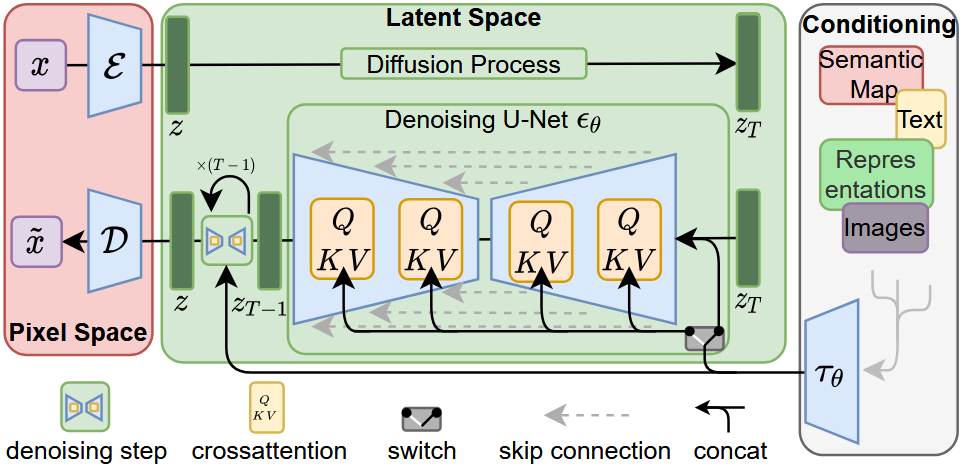
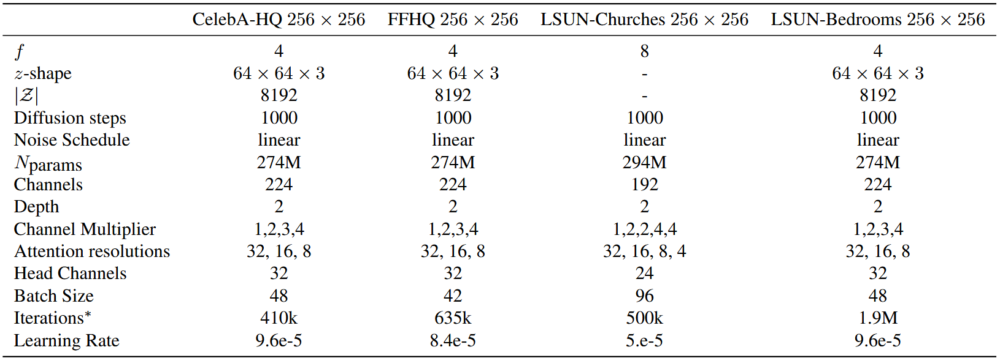
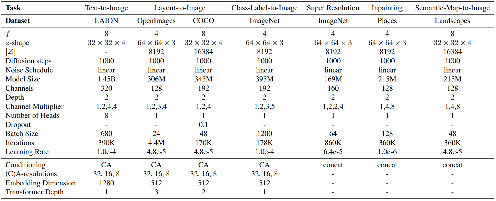

# CVPR 22 | High-Resolution Image Synthesis with Latent Diffusion Models

> 论文链接：https://doi.org/10.1109/CVPR52688.2022.01042
> 代码链接：https://github.com/CompVis/latent-diffusion
> 作者单位：慕尼黑大学

## 背景

先前的 Diffusion 模型在像素空间训练，计算成本高

基于似然的模型训练通常包含感知压缩（去除高频细节）和语义压缩（模型学习语义和概念）两个阶段

于是设计两阶段训练：自编码器提供感知等价的低维表示空间、在低维潜空间中训练 Diffusion 模型

## 方法

### 感知图像压缩

感知图像压缩：自编码器通过感知损失和基于 patch 的对抗损失共同训练，压缩和恢复过程可表示为：
$$
\begin{aligned}
z &= \mathcal{E}(x)\\
\tilde{x} &= \mathcal{D}(x)
\end{aligned}
$$
其中 $x\in\mathbb{R}^{H \times W \times C}, z\in\mathbb{R}^{h \times w \times c}$，下采样比例为 $f=H/h=W/w=2^m,m\in\mathbb{N}$

为了避免潜空间方差过高，施加趋向高斯分布的 KL 正则化，类似 VAE；或在解码器中加入一个矢量量化层，类似 VQGAN

选择 KL 正则化后需要对得到的潜空间 $z$ 进行缩放，即 $z=z/\hat{\sigma}$，实际应用中常取 $1/\hat{\sigma}=0.18215$

### 目标函数

原始 Diffusion 模型目标函数：
$$
L_{DM} = \mathbb{E}_{x,\epsilon\sim\mathcal{N}(0,1),t}[||\epsilon-\epsilon_\theta(x_t,t)||_2^2]
$$
本文提出的 Latent Diffusion 模型目标函数：
$$
L_{LDM} = \mathbb{E}_{\mathcal{E}(x),\epsilon\sim\mathcal{N}(0,1),t}[||\epsilon-\epsilon_\theta(z_t,t)||_2^2]
$$

### 条件化

使用交叉注意力注入条件：
$$
\begin{aligned}
\text{Attention}(Q,K,V) = \text{softmax}(\frac{QK^\top}{\sqrt{D}})\cdot V\\
Q = W_Q^{(i)}\cdot\varphi_i(z_t), K = W_K^{(i)}\cdot\tau_\theta(y), V = W_V^{(i)}\cdot\tau_\theta(y)
\end{aligned}
$$
其中，$\varphi_i(z_t)\in\mathbb{R}^{N \times d_\epsilon^i}, \tau_\theta(y)\in\mathbb{R}^{M \times d_\tau}$，可学习权重 $W_Q^{(i)}\in\mathbb{R}^{d \times d_\tau}, W_K^{(i)}\in\mathbb{R}^{d \times d_\tau}, W_V^{(i)}\in\mathbb{R}^{d \times d_\epsilon^i}$

带条件的 Latent Diffusion 模型目标函数：
$$
L_{LDM} = \mathbb{E}_{\mathcal{E}(x),y,\epsilon\sim\mathcal{N}(0,1),t}[||\epsilon-\epsilon_\theta(z_t,t,\tau_\theta(y))||_2^2]
$$

文本作条件时使用 BERT-tokenizer，使用 Transformer 实现条件编码器 $\tau_\theta$

CFG 能够显著提高生成质量并减少参数

## 具体实现

无条件模型超参数

有条件模型超参数

