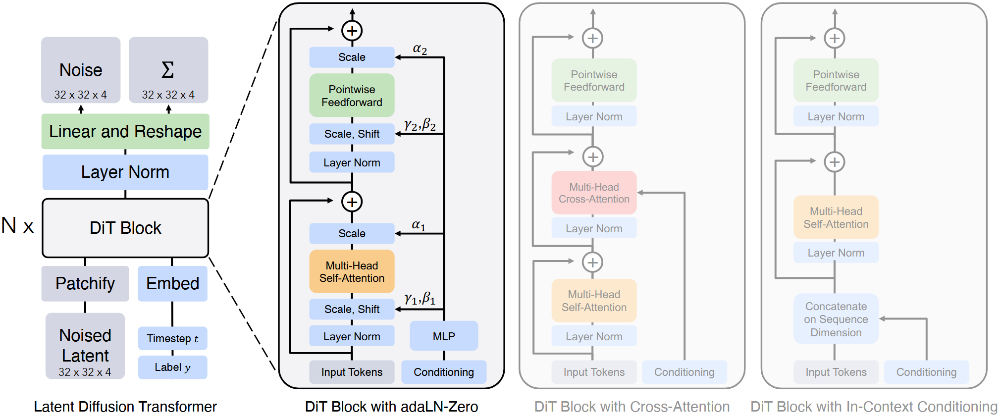
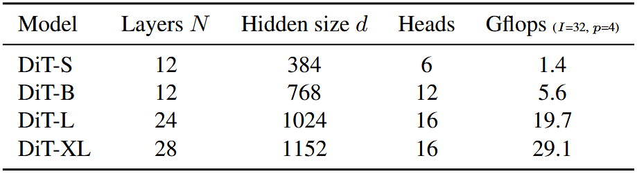

# ICCV 23 | Scalable Diffusion Models with Transformers

> 论文链接：https://doi.org/10.1109/ICCV51070.2023.00387
> 代码链接：https://www.wpeebles.com/DiT.html
> 作者单位：加州大学伯克利分校

## 方法

前置技术：DDPM、IDDPM、CFG、LDM

DiT 设计：
- 遵循标准 Transformer 结构设计
- 遵循标准 ViT 最佳实践
- 输入：对于 $256 \times 256 \times 3$ 的图像，潜空间压缩后的 $z\in\mathbb{R}^{32 \times 32 \times 4}$
- 分 Patch：patch size 越小计算量越高，但模型参数基本不变，不同模型变体中 patch size 取值为 $2,4,8$
- 位置编码：基于频率的正余弦固定位置编码，不参与参数更新
- 解码器：经过 DiT 块后使用 adaLN 调制一次，然后将隐藏层维度 $d$ 线性映射到 $p^22C$ 标准实践中输入通道数 $C=4$，最后将矩阵重排列回输入时的形状 $B,T,p^22C \rightarrow B,H/p, W/p,p^22C \rightarrow B,2C,H,W$
- 模型大小：关键参数有 DiT 块个数 $N$、隐藏层维度 $d$、多头注意力头数 $h$；分如下四种变体

DiT 块对条件处理的四种设计
- 上下文条件化：将时间戳 $t$ 和条件 $c$ 添加到图像 $z$ 的尾部，在最后一个块后剔除，类似 ViT 的 cls token，对计算量影响小
- 交叉注意力：时间戳 $t$ 和条件 $c$ 成为单独的序列与图像 $z$ 序列作交叉注意力，增加了 15% 的计算量
- 自适应层规范（adaLN）：使用时间戳 $t$ 和条件 $c$ 回归缩放和平移参数 $\gamma,\beta$，对图像 $z$ 进行调制，计算量增加最小
- 自适应层规范+恒等初始化（adaLN-Zero）：在 $\gamma,\beta$ 外，还回归了单独的缩放参数 $\alpha$ 用于残差之前，并将 $\alpha$ 初始化为零，使得残差连接为恒等变换，计算量的增加同样忽略不计

DiT 模型命名：模型变体名/patch size。如 DiT-XL/2 表示 XLarge 变体且 $p=2$

## 具体实现

- 初始化：解码器全零初始化，其他与 ViT 相同
- AdamW 优化器，固定 $1 \times 10^{-4}$ 学习率，weight decay 为零
- batch size 为 256
- 数据增强：水平翻转
- 使用指数滑动平均（EMA），衰减系数为0.9999
- Stable Diffusion 潜空间编码器，输入 $256 \times 256 \times 3$，输出 $32 \times 32 \times 4$
- 解码器使用 ft-EMA 性能更佳
- $T=1000$，$\beta_t$ 从 $1 \times 10^{-4}$ 到 $2 \times 10^{-2}$ 线性采样
- 模型结构探究使用 400K 次迭代，与其他模型对比使用 7M 次迭代
- 采样：250 步 DDIM