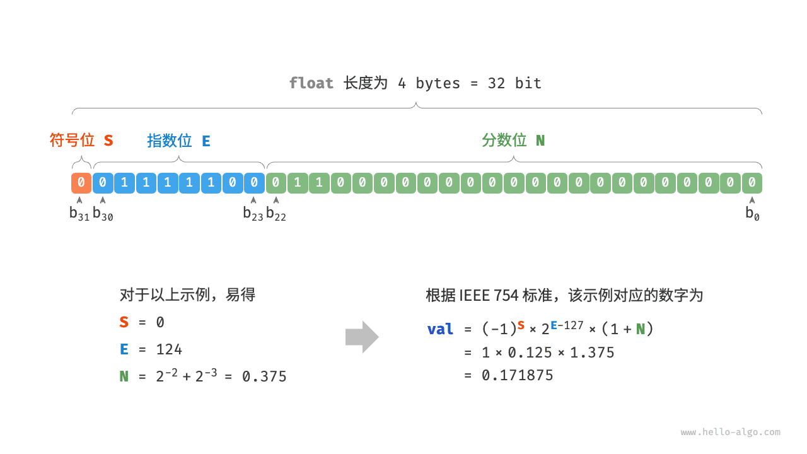

## 复杂度分析

定义：描述随着输入数据规模的增加，算法执行所需时间和空间的增长趋势

### 迭代与递归

- 尾递归：如果函数在返回前的最后一步才进行递归调用，则该函数可以被编译器或解释器优化，使其在空间效率上与迭代相当
  - 也有诸多编译器或解释器不支持尾递归优化，如 Python
  - 代码示例：
    ```py
    def recur(n: int) -> int:
        """递归"""
        # 终止条件
        if n == 1:
            return 1
        # 递：递归调用
        res = recur(n - 1)
        # 归：返回结果
        return n + res

    def tail_recur(n, res):
        """尾递归"""
        # 终止条件
        if n == 0:
            return res
        # 尾递归调用
        return tail_recur(n - 1, res + n)
    ```

### 时间复杂度

- 常见时间复杂度对应的算法：
  - 对数阶 $O(\log n)$：二分操作数
  - 线性阶 $O(n)$：数组遍历
  - 线性对数阶 $O(n\log n)$：快速排序、归并排序、堆排序
  - 平方阶 $O(n^2)$：冒泡排序
  - 指数阶 $O(2^n)$：递归树的节点数（操作数）
  - 阶乘阶 $O(n!)$：全排列方案数
- 最佳时间复杂度 $\Omega(\cdot)$、平均时间复杂度 $\Theta(\cdot)$、最差时间复杂度 $O(\cdot)$

### 空间复杂度

- 内存空间：输入空间、暂存空间（暂存数据、栈帧空间和指令空间）、输出空间
  - 通常不统计输入空间和指令空间
- 常见空间复杂度对应的操作：
  - 常数阶 $O(1)$：循环调用函数
  - 对数阶 $O(\log n)$：归并排序、正整数位数（$\lfloor\log_{10}n\rfloor+1$）
  - 线性阶 $O(n)$：数组、递归调用函数
  - 平方阶 $O(n^2)$：矩阵
  - 指数阶 $O(2^n)$：二叉树节点数（$n$ 层 $2^n-1$ 个节点）

## 数据结构

### 数字编码

- 整数是以“补码”的形式存储在计算机中的
- 整数编码定义：
  - 原码：我们将数字的二进制表示的最高位视为符号位，其中 $0$ 表示正数，$1$ 表示负数，其余位表示数字的值
  - 反码：正数的反码与其原码相同，负数的反码是对其原码除符号位外的所有位取反
  - 补码：正数的补码与其原码相同，负数的补码是在其反码的基础上加 $1$
- 动机：负数原码无法直接计算，发明反码可直接计算，反码存在正负零问题，发明补码用进位舍去统一零表示
- 浮点数编码定义：$1$ 位符号位、$8$ 位指数位和 $23$ 位分数位
  

**例题**：[191. 位1的个数](https://leetcode.cn/problems/number-of-1-bits/)
给定一个正整数 $n$，编写一个函数，获取一个正整数的二进制形式并返回其二进制表达式中 $1$（设置位） 的个数（也被称为汉明重量）
```py
class Solution:
    def hammingWeight(self, n: int) -> int:
        ans = 0
        while n:
            ans += 1
            n &= n - 1
        return ans
```
`n & (n - 1)` 会使得 $n$ 最右边的一个 $1$ 变成 $0$，统计需要几次操作会使 $n$ 变为 $0$ 即可得到 $1$ 的数量

### 链表

- 定义
  ```py
  class ListNode:
    """链表节点类"""
    def __init__(self, val: int):
        self.val: int = val               # 节点值
        self.next: ListNode | None = None # 指向下一节点的引用
  ```
- 访问节点
  ```py
  def access(head: ListNode, index: int) -> ListNode | None:
      """访问链表中索引为 index 的节点"""
      for _ in range(index):
          if not head:
              return None
          head = head.next
      return head
  ```
- 插入节点
  ```py
  def insert(n: ListNode, P: ListNode):
      """在链表的节点 n 之后插入节点 P"""
      n.next = P
      P.next = n.next
  ```
- 删除节点
  ```py
  def remove(n: ListNode):
      """删除链表的节点 n 之后的首个节点"""
      # 判断节点 n 之后时候还有节点
      if not n.next:
          return
      n.next = n.next.next
  ```
- 查找节点
  ```py
  def find(head: ListNode, target: int) -> int:
      """在链表中查找值为 target 的首个节点"""
      index = 0
      while head:
          if head.val == target:
              return index
          head = head.next
          index += 1
      return -1
  ```

**例题**：[206. 反转链表](https://leetcode.cn/problems/reverse-linked-list/)
给你单链表的头节点 head ，请你反转链表，并返回反转后的链表。
```py
# Definition for singly-linked list.
# class ListNode:
#     def __init__(self, val=0, next=None):
#         self.val = val
#         self.next = next
class Solution:
    def reverseList(self, head: Optional[ListNode]) -> Optional[ListNode]:
        cur = head
        pre = nxt = None
        while cur:
            nxt = cur.next
            cur.next = pre
            pre = cur
            cur = nxt
        return pre
```
沿链表遍历，利用 nxt 钩住前进方向，将 cur 反转指向 pre，再逐步前进

### 列表

Python 实现列表基础操作
```py
# 初始化
nums: list[int] = []               # 无初始值
nums: list[int] = [1, 3, 2, 5, 4]  # 有初始值
n = 10
nums: list[int] = [0] * n          # 扩展初始值

# 访问元素
num: int = nums[1]  # 访问索引 1 处的元素

# 添加元素
nums.append(1)     # 在尾部添加
nums.insert(3, 6)  # 在中间插入，在索引 3 处插入数字 6

# 删除元素
nums.pop(3)  # 删除索引 3 处的元素

# 更新元素
nums[1] = 0  # 将索引 1 处的元素更新为 0

# 遍历元素
for i in range(len(nums)):  # 通过索引遍历
    print(nums[i])
for num in nums:            # 直接遍历
    print(num)

# 拼接列表
nums1: list[int] = [6, 8, 7, 10, 9]
nums += nums1  # 将列表 nums1 拼接到 nums 之后

# 排序列表
nums.sort()  # 元素从小到大排列

# 清空列表
nums.clear()
```

### 栈

Python 实现栈基础操作
```py
# 初始化
stack: list[int] = []  # Python 没有内置的栈类，可以把 list 当作栈来使用

# 访问栈顶元素
peek: int = stack[-1]

# 入栈
stack.append(1)

# 出栈
pop: int = stack.pop()

# 获取栈的长度
size: int = len(stack)

# 判断栈是否为空
is_empty: bool = len(stack) == 0
```

### 队列

Python 实现队列基础操作
```py
from collections import deque

# 初始化
# 在 Python 中，我们一般将双向队列类 deque 当作队列使用
# 虽然 queue.Queue() 是纯正的队列类，但实际定位是协调任务的消息队列，作为数据结构不太好用，因此不推荐
que: deque[int] = deque()

# 访问队首元素
front: int = que[0]

# 入队
que.append(1)

# 出队
pop: int = que.popleft()

# 获取队列的长度
size: int = len(que)

# 判断队列是否为空
is_empty: bool = len(que) == 0
```

### 双向队列

Python 实现双向队列基础操作
```py
from collections import deque

# 初始化
deq: deque[int] = deque()

# 访问元素
front: int = deq[0]  # 队首元素
rear: int = deq[-1]  # 队尾元素

# 元素入队
deq.append(1)      # 添加至队尾
deq.appendleft(1)  # 添加至队首

# 元素出队
pop_front: int = deq.popleft()  # 队首元素出队
pop_rear: int = deq.pop()       # 队尾元素出队

# 获取双向队列的长度
size: int = len(deq)

# 判断双向队列是否为空
is_empty: bool = len(deq) == 0
```

### 哈希表

Python 实现哈希表基础操作
```py
# 初始化
hmap: dict = {}

# 访问元素
name: str = hmap[15937]  # 访问 key 为 15937 的 value

# 添加元素
hmap[12836] = "小哈"

# 删除元素
hmap.pop(10583)

# 遍历元素
for key, value in hmap.items():  # 遍历键值对 key->value
    print(key, "->", value)
for key in hmap.keys():          # 单独遍历键 key
    print(key)
for value in hmap.values():      # 单独遍历值 value
    print(value)
```

### 二叉树

基本概念
- 节点的度（degree）：节点的子节点的数量，在二叉树中，度的取值范围是 $0$、$1$、$2$
- 节点的深度（depth）：从根节点到该节点所经过的边的数量
- 节点的高度（height）：从距离该节点最远的叶节点到该节点所经过的边的数量
  - 注意：有时可能会将深度和高度定义为“经过的节点的数量”，此时相比边的数量，高度和深度都需要加 $1$

Python 实现二叉树基础操作
```py
class TreeNode:
    """二叉树节点类"""
    def __init__(self, val: int):
        self.val: int = val                # 节点值
        self.left: TreeNode | None = None  # 左子节点引用
        self.right: TreeNode | None = None # 右子节点引用

# 初始化
# 初始化节点
n1 = TreeNode(val=1)
n2 = TreeNode(val=2)
n3 = TreeNode(val=3)
# 构建节点之间的引用（指针）
n1.left = n2
n1.right = n3

# 插入节点
p = TreeNode(0)
# 在 n1 -> n2 中间插入节点 P
n1.left = p
p.left = n2

# 删除节点 P
n1.left = n2
```

特殊二叉树
- 完美二叉树（满二叉树）：所有层的节点都被完全填满
  - 叶节点度为 $0$，其余节点度为 $2$；若树高为 $h$，则叶节点数为 $2^h$，节点总数为 $2^{h+1}-1$；第 $i$ 层有 $2^{i-1}$ 个节点；节点总数为 $n$ 的树的高度为 $\log_2 (n+1)-1$
- 完全二叉树：仅允许最底层的节点不完全填满，且最底层的节点必须从左至右依次连续填充
- 完满二叉树：除了叶节点之外，其余所有节点都有两个子节点
- 平衡二叉树：任意节点的左子树和右子树的高度之差的绝对值不超过 $1$

树的遍历
- 层序遍历：广度优先搜索（BFS）通常借助队列实现，遍历满二叉树时空间复杂度最大，队列最多同时存在 $(n+1)/2$ 个节点，$n$ 为总节点数
  ```py
  def level_order(root: TreeNode | None) -> list[int]:
      """层序遍历"""
      # 初始化队列，加入根节点
      queue: deque[TreeNode] = deque()
      queue.append(root)
      # 初始化一个列表，用于保存遍历序列
      res = []
      while queue:
          node: TreeNode = queue.popleft()  # 队列出队
          res.append(node.val)  # 保存节点值
          if node.left is not None:
              queue.append(node.left)  # 左子节点入队
          if node.right is not None:
              queue.append(node.right)  # 右子节点入队
      return res
  ```
- 前序、中序、后续遍历：深度优先搜索（DFS）
  ```py
  def pre_order(root: TreeNode | None) -> list[int]:
      """前序遍历"""
      res = []
      def dfs(root: TreeNode | None):
          if root is None:
              return
          # 访问优先级：根节点 -> 左子树 -> 右子树
          res.append(root.val)
          dfs(root=root.left)
          dfs(root=root.right)
      dfs(root=root)
      return res
  def in_order(root: TreeNode | None) -> list[int]:
      """中序遍历"""
      res = []
      def dfs(root: TreeNode | None):
          if root is None:
              return
          # 访问优先级：左子树 -> 根节点 -> 右子树
          dfs(root=root.left)
          res.append(root.val)
          dfs(root=root.right)
      dfs(root=root)
      return res
  def post_order(root: TreeNode | None) -> list[int]:
      """后序遍历"""
      res = []
      def dfs(root: TreeNode | None):
          if root is None:
              return
          # 访问优先级：左子树 -> 右子树 -> 根节点
          dfs(root=root.left)
          dfs(root=root.right)
          res.append(root.val)
      dfs(root=root)
      return res
  ```

用数组表示二叉树
- 完美二叉树：若某节点的索引为 $i$，则该节点的左子节点索引为 $2i+1$，右子节点索引为 $2i+2$，父节点索引为 $(i-1)//2$
  - 对于非完美二叉树，由于中间层有 `None` 的存在，该方法不能唯一表示一棵二叉树，若显式写出所有 `None` 则依旧有效
- 完全二叉树：`None` 全在末尾，相当于显式写出，可唯一表示
- 层序遍历与前序、中序、后序遍历转换
  ```py
  def level2pre(arr: list[int]) -> list[int]:
      """层序转前序"""
      res = []
      def dfs(i: int):
          if i >= len(arr):
              return
          res.append(arr[i])
          dfs(2 * i + 1)
          dfs(2 * i + 2)
      dfs(0)
      return res
  def level2in(arr: list[int]) -> list[int]:
      """层序转中序"""
      res = []
      def dfs(i: int):
          if i >= len(arr):
              return
          dfs(2 * i + 1)
          res.append(arr[i])
          dfs(2 * i + 2)
      dfs(0)
      return res
  def level2post(arr: list[int]) -> list[int]:
      """层序转后序"""
      res = []
      def dfs(i: int):
          if i >= len(arr):
              return
          dfs(2 * i + 1)
          dfs(2 * i + 2)
          res.append(arr[i])
      dfs(0)
      return res
  ```
  该实现的返回结果中包含 `None`，若不想包含则将 `dfs()` 的终止条件换成 `if i >= len(arr) or arr[i] is None:`

### 二叉搜索树

定义
- 对于根节点，左子树中所有节点的值 < 根节点的值 < 右子树中所有节点的值
- 且任意节点的左、右子树也是二叉搜索树
- 注意：二叉搜索树不允许有重复节点
- 性质：中序遍历序列为升序

查找节点 $O(\log n)$
```py
def search(root: TreeNode, num: int) -> TreeNode | None:
    """查找节点"""
    cur = root
    # 循环查找，越过叶节点后跳出
    while cur is not None:
        # 目标节点在 cur 的右子树中
        if cur.val < num:
            cur = cur.right
        # 目标节点在 cur 的左子树中
        elif cur.val > num:
            cur = cur.left
        # 找到目标节点，跳出循环
        else:
            break
    return cur
```

插入节点 $O(\log n)$
- 二叉搜索树不允许存在重复节点，否则将违反其定义。因此，若待插入节点在树中已存在，则不执行插入，直接返回
- 为了实现插入节点，我们需要借助节点 `pre` 保存上一轮循环的节点。这样在遍历至 `None` 时，我们可以获取到其父节点，从而完成节点插入操作
```py
def insert(root: TreeNode | None, num: int) -> TreeNode:
    """插入节点"""
    # 若树为空，则初始化根节点
    if root is None:
        root = TreeNode(num)
        return root
    # 循环查找，越过叶节点后跳出
    cur, pre = root, None
    while cur is not None:
        # 找到重复节点，直接返回
        if cur.val == num:
            return root
        pre = cur
        # 插入位置在 cur 的右子树中
        if cur.val < num:
            cur = cur.right
        # 插入位置在 cur 的左子树中
        else:
            cur = cur.left
    # 插入节点
    node = TreeNode(num)
    if pre.val < num:
        pre.right = node
    else:
        pre.left = node
    return root
```

删除节点 $O(\log n)$
- 当待删除节点度为 $0$ 时：直接删除
- 当待删除节点度为 $1$ 时：将待删除节点替换为其子节点
- 当待删除节点度为 $2$ 时：将待删除节点替换为右子树的最小节点或左子树的最大节点，择一即可

```py
def remove(root: TreeNode | None, num: int) -> TreeNode | None:
    """删除节点"""
    # 若树为空，直接提前返回
    if root is None:
        return root
    # 循环查找，越过叶节点后跳出
    cur, pre = root, None
    while cur is not None:
        # 找到待删除节点，跳出循环
        if cur.val == num:
            break
        pre = cur
        # 待删除节点在 cur 的右子树中
        if cur.val < num:
            cur = cur.right
        # 待删除节点在 cur 的左子树中
        else:
            cur = cur.left
    # 若无待删除节点，则直接返回
    if cur is None:
        return root

    # 子节点数量 = 0 or 1
    if cur.left is None or cur.right is None:
        # 当子节点数量 = 0 / 1 时， child = null / 该子节点
        child = cur.left or cur.right
        # 删除节点 cur
        if cur != root:
            if pre.left == cur:
                pre.left = child
            else:
                pre.right = child
        else:
            # 若删除节点为根节点，则重新指定根节点
            root = child
    # 子节点数量 = 2
    else:
        # 获取中序遍历中 cur 的下一个节点
        tmp: TreeNode = cur.right
        while tmp.left is not None:
            tmp = tmp.left
        # 用 tmp 覆盖 cur
        cur.val = tmp.val
        # 递归删除节点 tmp
        # 必须使用 cur.right 接回返回值，因为当删除的是根节点时不接回会导致删除失效
        cur.right = remove(cur.right, tmp.val)
    return root
```

### AVL 树

动机：防止二叉搜索树在多次插入和删除后退化为链表

定义：既是二叉搜索树，又是平衡二叉树，即平衡二叉搜素树

概念
- 节点高度：从该节点到它的最远叶节点的距离，即所经过的“边”的数量
  - 叶节点高度为 $0$，空节点高度为 $-1$
- 节点的平衡因子：左子树的高度减去右子树的高度，空节点平衡因子为 $0$
  - 设平衡因子为 $f$，则 AVL 树的任意节点满足 $-1 \le f \le 1$
- 失衡节点：平衡因子绝对值 $\ge 1$ 的节点

AVL 树旋转
在保持二叉搜索树的性质的前提下，使树重新变为平衡二叉树

## 算法